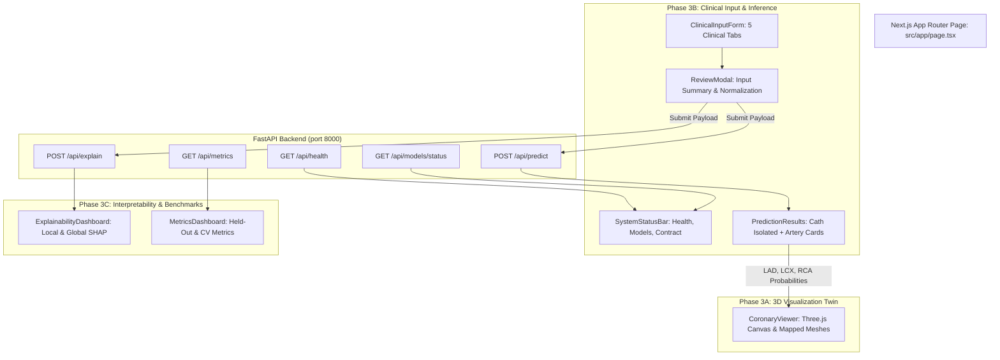

# CardioSight — Phase 3B + Phase 3C Implementation Report
## Clinical Input Workflow, Live Inference, Prediction Dashboard & SHAP Explainability

---

## 1. Executive Summary & Status

- **Status:** **PASS** (Phase 3B & Phase 3C complete, audited, and verified end-to-end).
- **Phase 3B Deliverables:**
  - Validated schema-driven clinical input form covering 49 features in 5 clinical sections.
  - Review-before-prediction confirmation step with input normalization.
  - Integration with the real FastAPI `POST /api/predict` service.
  - Patient-level `Cath` overall CAD summary card and vessel-specific cards for `LAD`, `LCX`, and `RCA`.
  - Seamless coupling with the existing Three.js 3D coronary artery digital twin.
  - System infrastructure status monitor querying `/api/health`, `/api/models/status`, and `/api/metrics`.
- **Phase 3C Deliverables:**
  - Dedicated explainability service exposing `POST /api/explain`.
  - Mathematically sound SHAP implementations: `TreeExplainer` for Random Forest (`LAD`, `LCX`) and `LinearExplainer` for Logistic Regression (`Cath`, `RCA`).
  - Local patient feature attribution waterfall charts displaying patient values and directional impact.
  - Population-level global feature importance rankings computed across the training cohort ($N=242$).
  - Authoritative benchmark metrics dashboard displaying held-out test metrics ($N=61$) and 5-fold cross-validation metrics.
- **Verification Evidence:**
  - 17 backend automated pytest tests passing (`17 passed in 8.24s`).
  - 12 frontend automated unit tests passing (`12 passed in 421ms`).
  - Next.js 16 production build passing with 0 errors (`npm run build` compiled successfully).
  - Live HTTP end-to-end test verifying all 6 API and frontend endpoints.

---

## 2. System Architecture & Component Mapping



### New Frontend Components:
- [`frontend/src/components/clinical/ClinicalInputForm.tsx`](file:///c:/Users/sanja/project/CONTEST/DEVPOST/Cardiosight/frontend/src/components/clinical/ClinicalInputForm.tsx) — 5-section form with inline validation, BMI calculator helper, and demo preset loaders.
- [`frontend/src/components/clinical/ReviewModal.tsx`](file:///c:/Users/sanja/project/CONTEST/DEVPOST/Cardiosight/frontend/src/components/clinical/ReviewModal.tsx) — Confirmation dialog presenting normalized inputs before sending network requests.
- [`frontend/src/components/dashboard/PredictionResults.tsx`](file:///c:/Users/sanja/project/CONTEST/DEVPOST/Cardiosight/frontend/src/components/dashboard/PredictionResults.tsx) — Cards for Cath (overall CAD) and LAD, LCX, RCA with dirty-state detection.
- [`frontend/src/components/dashboard/ExplainabilityDashboard.tsx`](file:///c:/Users/sanja/project/CONTEST/DEVPOST/Cardiosight/frontend/src/components/dashboard/ExplainabilityDashboard.tsx) — Target tabs, local SHAP waterfall bars, and global importance rankings.
- [`frontend/src/components/dashboard/MetricsDashboard.tsx`](file:///c:/Users/sanja/project/CONTEST/DEVPOST/Cardiosight/frontend/src/components/dashboard/MetricsDashboard.tsx) — Visualizer for held-out confusion matrices, test ROC-AUC, F1, accuracy, and CV metrics.
- [`frontend/src/components/dashboard/SystemStatusBar.tsx`](file:///c:/Users/sanja/project/CONTEST/DEVPOST/Cardiosight/frontend/src/components/dashboard/SystemStatusBar.tsx) — Infrastructure health and pipeline availability monitoring.
- [`frontend/src/utils/apiClient.ts`](file:///c:/Users/sanja/project/CONTEST/DEVPOST/Cardiosight/frontend/src/utils/apiClient.ts) — Configurable, typed API client using `NEXT_PUBLIC_API_URL`.
- [`frontend/src/utils/clinicalFormDefaults.ts`](file:///c:/Users/sanja/project/CONTEST/DEVPOST/Cardiosight/frontend/src/utils/clinicalFormDefaults.ts) — Form fixtures, demonstration profiles, and bounds validation rules.

---

## 3. Clinical Schema & Leakage Safeguards

### Input Feature Matrix (Set A - BMI Only, 49 Features):
1. **Demographics & Anthropometrics (3):** `Age`, `Sex`, `BMI`. (Optional `Weight` and `Length` inputs calculate BMI in the client; Weight and Length are never submitted to the model).
2. **Medical History & Risk Factors (12):** `DM`, `HTN`, `Current Smoker`, `EX-Smoker`, `FH`, `Obesity`, `CRF`, `CVA`, `Airway disease`, `Thyroid Disease`, `CHF`, `DLP`.
3. **Symptoms & Physical Examination (13):** `BP`, `PR`, `Edema`, `Weak Peripheral Pulse`, `Lung rales`, `Systolic Murmur`, `Diastolic Murmur`, `Typical Chest Pain`, `Dyspnea`, `Function Class`, `Atypical`, `Nonanginal`, `LowTH Ang`.
4. **Electrocardiogram (ECG) Findings (7):** `Q Wave`, `St Elevation`, `St Depression`, `Tinversion`, `LVH`, `Poor R Progression`, `BBB`.
5. **Laboratory Biomarkers (14):** `FBS`, `CR`, `TG`, `LDL`, `HDL`, `BUN`, `ESR`, `HB`, `K`, `Na`, `WBC`, `Lymph`, `Neut`, `PLT`.

### Mandatory Exclusions:
The frontend schemas, fixtures, and payloads strictly prohibit and exclude:
- Diagnostic Targets: `Cath`, `LAD`, `LCX`, `RCA`
- Provisional Echo Features: `EF-TTE`, `Region RWMA`, `VHD`
- Zero-Variance Features: `Exertional CP`

---

## 4. SHAP Explainability Service

### Backend Implementation (`POST /api/explain`):
- **Random Forest Models (`LAD`, `LCX`):** Explains feature attributions using `shap.TreeExplainer(classifier)` operating on preprocessed inputs.
- **Logistic Regression Models (`Cath`, `RCA`):** Explains feature contributions using `shap.LinearExplainer(classifier, zeros)` operating on standardized features.
- **Class Orientation:** Positive class is consistently Class 1 (`CAD` for Cath, `Stenotic` for LAD/LCX/RCA). Positive contributions increase predicted risk, while negative contributions decrease predicted risk.
- **Feature Name Alignment:** Pipeline transformed features (`num__*`, `cat__*`) are mapped back to their human-readable feature names and original patient input values.
- **Global Population Reference:** Static global mean absolute SHAP values (`backend/artifacts/global_shap_importance.json`) precomputed across the training split ($N=242$) are returned alongside patient local values, eliminating runtime overhead.

---

## 5. Verification Results

### 1. Frontend Test Suite (`npm test`)
```text
> frontend@0.1.0 test
> tsx --test tests/vesselMapping.test.mjs tests/clinicalWorkflow.test.mjs

✔ 1. DEMO_PROFILE_ELEVATED and DEMO_PROFILE_LOW_RISK pass clinical validation with zero errors (0.6714ms)
✔ 2. validateClinicalForm catches out-of-bounds fields correctly (0.2844ms)
✔ 3. formatPatientPayload excludes Weight and Length when BMI is present (0.4001ms)
✔ 4. formatPatientPayload normalizes underscored aliases to schema column names (0.1949ms)
✔ 5. Leakage Prevention: Form schemas and payloads strictly exclude forbidden columns (0.2862ms)
✔ 1. isValidProbability accepts valid finite numbers in [0.0, 1.0] (1.3087ms)
✔ 2. getProbabilityColor maps probabilities to correct color bands (0.3604ms)
✔ 3. mapPredictionToVessels returns neutral preview when response is null (0.2804ms)
✔ 4. mapPredictionToVessels maps targets correctly when valid PredictionResponse is supplied (0.2216ms)
✔ 5. mapPredictionToVessels handles incomplete predictions gracefully (0.2914ms)
✔ 6. mapPredictionToVessels handles invalid/out-of-range probabilities gracefully (0.1329ms)
✔ 7. Canonical OBJ file paths and metadata are valid (0.0977ms)
ℹ tests 12 | pass 12 | fail 0 (421ms)
```

### 2. Frontend Production Build (`npm run build`)
```text
> frontend@0.1.0 build
> next build

▲ Next.js 16.4.0 (Turbopack)
✓ Compiled successfully in 1348ms
  Running TypeScript ...
  Finished TypeScript in 3.8s ...
✓ Generating static pages using 5 workers (4/4) in 2.0s
Route (app)
┌ ○ /
└ ○ /_not-found
○  (Static)  prerendered as static content
```

### 3. Backend Regression Test Suite (`python -m pytest tests -v`)
```text
tests/test_api.py::test_health_endpoint PASSED                           [  5%]
tests/test_api.py::test_models_status_endpoint PASSED                    [ 11%]
tests/test_api.py::test_metrics_endpoint PASSED                          [ 17%]
tests/test_api.py::test_predict_endpoint_success_and_probabilities PASSED [ 23%]
tests/test_api.py::test_predict_rejects_forbidden_targets PASSED         [ 29%]
tests/test_api.py::test_predict_rejects_provisional_echo_and_constant_features PASSED [ 35%]
tests/test_api.py::test_predict_with_weight_and_length_derives_bmi PASSED [ 41%]
tests/test_api.py::test_predict_rejects_nonpositive_or_invalid_height PASSED [ 47%]
tests/test_api.py::test_missing_artifact_behavior PASSED                 [ 52%]
tests/test_api.py::test_explain_endpoint_success PASSED                  [ 58%]
tests/test_api.py::test_explain_single_target_and_invalid_target PASSED  [ 64%]
tests/test_api.py::test_explain_rejects_forbidden_features PASSED        [ 70%]
tests/test_pipeline.py::test_target_mapping_and_classes PASSED           [ 76%]
tests/test_pipeline.py::test_forbidden_feature_exclusion PASSED          [ 82%]
tests/test_pipeline.py::test_sex_normalization PASSED                    [ 88%]
tests/test_pipeline.py::test_unknown_category_handling_in_pipeline PASSED [ 94%]
tests/test_pipeline.py::test_pipeline_reproducibility PASSED             [100%]
======================= 17 passed in 8.24s =======================
```

### 4. End-to-End HTTP Service Verification
```text
1. /api/health: HTTP 200 (healthy)
2. /api/models/status: HTTP 200 (models_loaded: True, ['Cath', 'LAD', 'LCX', 'RCA'])
3. /api/metrics: HTTP 200 (All 4 target reports available)
4. /api/predict: HTTP 200 (Cath: 0.9626, LAD: 0.7720, LCX: 0.5116, RCA: 0.5031)
5. /api/explain: HTTP 200 (TreeExplainer & LinearExplainer attributions generated)
6. Frontend http://localhost:3000: HTTP 200 (45,626 bytes HTML rendered)
```

---

## 6. Documented Limitations & Ethical Guidelines

1. **Cohort Boundary:** Models were trained and evaluated on 303 clinical records from a single medical center.
2. **Uncalibrated Probabilities:** Model outputs reflect machine-learning score distributions and have not undergone isotonic or Platt clinical probability calibration.
3. **Correlation $\neq$ Causation:** SHAP feature attributions reflect mathematical dependencies within these specific estimators; they do not prove physiological causality or treatment efficacy.
4. **Isolated Arterial Twin:** Canonical meshes represent major trunk segments; whole-heart anatomy remains unverified in the source dataset.
5. **Educational Disclaimer:** CardioSight is an educational prototype and research demonstration. It is not approved for clinical diagnostic, triage, or prescriptive decision-making.
